# Sondhan — System Architecture and Dataflow

> **Living document.** This file is the high-level map of the service. Update it
> in the same change that alters a component, data store, API surface, event
> flow, or deployment topology. See
> [Keeping this document current](#16-keeping-this-document-current).

Sondhan is a Spring Boot backend for finding nearby blood donors. It handles
donor registration, OTP verification, JWT authentication, donor search,
blood-request creation, donor notifications, audit logging, and an
event-driven search read model.

The short version:

* **PostgreSQL is the source of truth.** All business state, PII tokens, OTPs,
  outbox rows, idempotency markers and audit records live there.
* **Kafka carries domain events** for search indexing, geo enrichment and email
  delivery. Topics are versioned, with retry and dead-letter variants.
* **Redis holds ephemeral state** — token whitelisting, OTP counters, auth
  failure counters, geocoding cache — and is a clustered cache, not a source of
  truth.
* **Elasticsearch is a derived read model** for registered donors. It can be
  rebuilt from PostgreSQL and `user.registered` events, but there is no
  automated reindex job yet.
* **Email is sent through a transactional outbox**, never directly from a
  business transaction.
* **Geo enrichment is asynchronous** for new donors, with a scheduled worker,
  claim-based locking and bounded retries.

---

## 1. System context

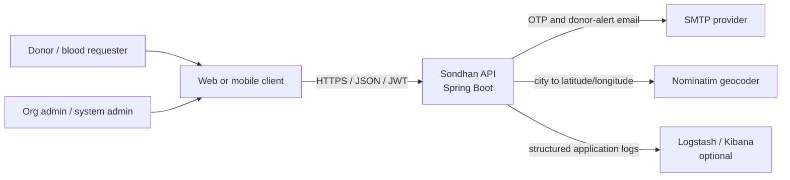

The API is stateless from the client's point of view: clients authenticate with
a bearer token and never rely on a server-side HTTP session. The Spring Session
dependency is on the classpath, but no session store is configured or enabled;
the JWT filter and `STATELESS` policy govern request authentication.

---

## 2. Container and runtime view

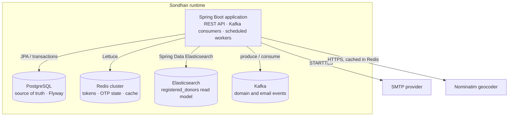

Runtime characteristics:

| Concern | Behaviour |
| --- | --- |
| HTTP port / context path | `8088`, `/sondhan` |
| API docs | Swagger UI at `/sondhan/swagger-ui/index.html` (disable with `SPRINGDOC_ENABLED=false`) |
| Health | `/sondhan/actuator/health`, `/sondhan/actuator/health/liveness`, `/sondhan/actuator/health/readiness` |
| Shutdown | Graceful; in-flight requests finish, consumers stop cleanly |
| Configuration | `.env` in development; environment variables / Docker secrets in deployment |
| Schema | Flyway migrations under `src/main/resources/db/migration` |
| JPA | `ddl-auto=validate`; Flyway owns the schema |

Deployment topology, Compose files and production rules are documented in
[docs/container-deployment.md](container-deployment.md).

---

## 3. Inside the application

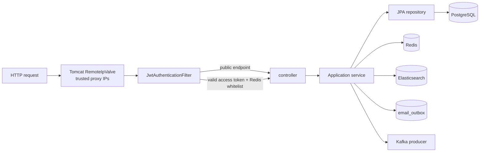

Package responsibilities:

| Package area | Responsibility |
| --- | --- |
| `controller` | REST endpoints and request/response mapping |
| `service` | Use cases: auth, users, search, blood requests, OTP, mail, audit |
| `service/es` | Elasticsearch donor indexing and admin search |
| `repository` | Spring Data JPA and Elasticsearch repositories |
| `kafka` | Events, topics, producers, consumers, retry/DLQ, outbox, idempotency |
| `worker` | Scheduled geo-enrichment and outbox-relay jobs |
| `security` | JWT filter, key provider, principal, CORS, entry points |
| `search` | Redis GEO hot-path building blocks and search DTOs (not yet wired to an endpoint) |
| `model` / `payload` | JPA entities, Elasticsearch documents, enums, requests/responses |
| `config` | Kafka, Redis, Elasticsearch, async, cache, ShedLock, security, mail |
| `exception` | Domain exceptions and the global JSON error handler |

Cross-cutting behaviour:

* **Request ID** — the log pattern reserves a `requestId` MDC field, but no
  filter currently populates it, so request correlation is not yet emitted.
  This is noted in [known gaps](#15-known-gaps-and-current-state).
* **Trusted proxy handling** is done by Tomcat's `RemoteIpValve`; application
  code never reads `X-Forwarded-For` directly. This prevents client IP
  spoofing that would defeat auth rate limits.
* **Errors** are returned as a consistent `ApiErrorResponse`. Stack traces and
  internal exception messages are never exposed to clients.
* **Audit entries** are written asynchronously in a separate transaction, so a
  failed audit insert cannot roll back a login or registration.

---

## 4. Domain data model

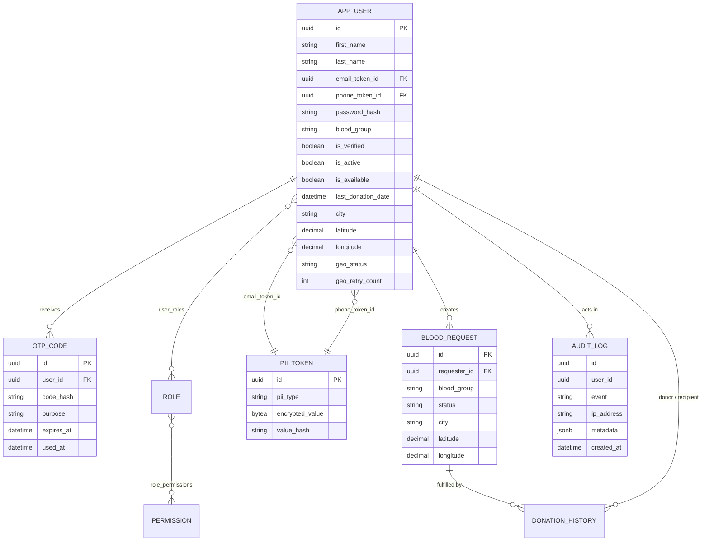

### PostgreSQL tables

| Table | Purpose |
| --- | --- |
| `app_user` | Donor / requester account, hashed password, status flags, embedded geo location and geo-enrichment state |
| `pii_tokens` | Encrypted email / phone values plus a keyed lookup hash |
| `roles`, `permissions`, `user_roles`, `role_permissions` | Role-based access control |
| `otp_codes` | Hashed, single-use OTPs with purpose and expiry |
| `blood_request` | Blood requests created by authenticated users |
| `donation_history` | Recorded donations between donor, recipient and request |
| `audit_logs` | Security and account events, range-partitioned by `created_at` |
| `processed_events` | Consumer idempotency markers keyed by Kafka `eventId` |
| `email_outbox` | Transactional outbox for email notifications |
| `shedlock` | Distributed scheduler locks for multi-instance deployments |
| `event_tracker` | Legacy event-tracking table; the current consumer path uses `processed_events` |
| `flyway_schema_history` | Applied migration history |

### Elasticsearch

| Index | Written by | Read by | Content |
| --- | --- | --- | --- |
| `registered_donors` | `UserRegisteredEventHandler`, `GeoEnrichedEventHandler` | Admin Elasticsearch endpoints | Donor profile for search, including geo point and PII **token ids** (never raw email/phone) |

`donor_search_index` is referenced by the admin paginated-search repository
configuration. See [known gaps](#15-known-gaps-and-current-state) for the index
alignment caveat.

### Redis key families

| Key family | Purpose | TTL / notes |
| --- | --- | --- |
| `auth:whitelist:access:<jti>` | Access-token allow-list | Remaining token lifetime |
| `auth:whitelist:refresh:<jti>` | Refresh-token allow-list | Remaining token lifetime |
| `auth:user:access:<userId>`, `auth:user:refresh:<userId>` | Per-user token index for bulk revocation | Longest token lifetime |
| `auth:failure:<sha256(scope|ip|subject)>` | Login / OTP failure counters | Configured window |
| `otp:rl:<sha256(recipient)>` | OTP request rate limit | 1 hour |
| `otp:<userId>:<purpose>` | OTP state marker | OTP lifetime |
| `sondhan::<cache>::<key>` | Spring Cache entries | Per-cache TTL |
| `geo:donors:<bloodGroup>` | Reserved Redis GEO donor index | Not currently written by the active search path |
| `search:rl:<userId>` | Reserved Redis GEO search rate limit | 1 minute |

Redis Cluster is used in Compose (3 masters, 3 replicas). Multi-key operations
are avoided deliberately because keys can live in different hash slots.

---

## 5. API surface

All paths are relative to `/sondhan`. Authentication is a bearer access token
unless the endpoint is marked public.

| Method | Path | Access | Purpose |
| --- | --- | --- | --- |
| `POST` | `/api/auth/register` | Public | Create an unverified account and send a registration OTP |
| `POST` | `/api/auth/verify-otp` | Public | Verify registration or login OTP; may return a token pair |
| `POST` | `/api/auth/resend-otp` | Public | Re-issue an OTP for a supported purpose |
| `POST` | `/api/auth/login` | Public | Password login; returns access + refresh tokens |
| `POST` | `/api/auth/refresh` | Public (refresh token) | Rotate a refresh token into a new token pair |
| `POST` | `/api/auth/logout` | Public (tokens supplied) | Revoke the supplied access and refresh tokens |
| `GET` | `/api/auth/jwks.json` | Public | Publish the RSA public key as a JWK Set |
| `PUT` | `/api/user/me` | Authenticated | Update the caller's own profile |
| `POST` | `/api/user/update` | Authenticated | Backwards-compatible alias for `/me` (ignores any client-supplied user id) |
| `POST` | `/api/blood-request/create` | Authenticated | Create a blood request owned by the caller |
| `POST` | `/api/search/eligible-donors` | Authenticated | Find nearby donors who pass the eligibility filter |
| `POST` | `/api/search/notify-near-by-donors` | `SUPER_ADMIN`, `ORG_ADMIN` | Queue donor-alert emails for nearby eligible donors |
| `POST` | `/api/mail/send` | `SUPER_ADMIN`, `ORG_ADMIN` | Send a mail through the mail service |
| `POST` | `/es/users/save` | `SUPER_ADMIN`, `ORG_ADMIN` | Administrative donor index write |
| `GET` | `/es/users/search_by_bloodgroup` | `SUPER_ADMIN`, `ORG_ADMIN` | Administrative donor search by blood group |
| `POST` | `/es/users/search-user` | `SUPER_ADMIN`, `ORG_ADMIN` | Administrative paginated donor search |
| `GET` | `/actuator/health`, `/actuator/health/liveness`, `/actuator/health/readiness` | Public | Container / orchestrator probes |
| `GET` | `/actuator/**` (other) | `SUPER_ADMIN`, `ORG_ADMIN` | Actuator endpoints; only health/info are exposed |

---

## 6. Authentication and authorization

Authentication uses **RS256 JWTs** with a public JWKS endpoint. Access tokens
are short-lived (`1200 s` by default); refresh tokens are long-lived
(`604800 s`). Every issued token is also recorded in Redis by `jti`. A token is
accepted only when its signature, issuer, expiry, type and Redis whitelist entry
are all valid.

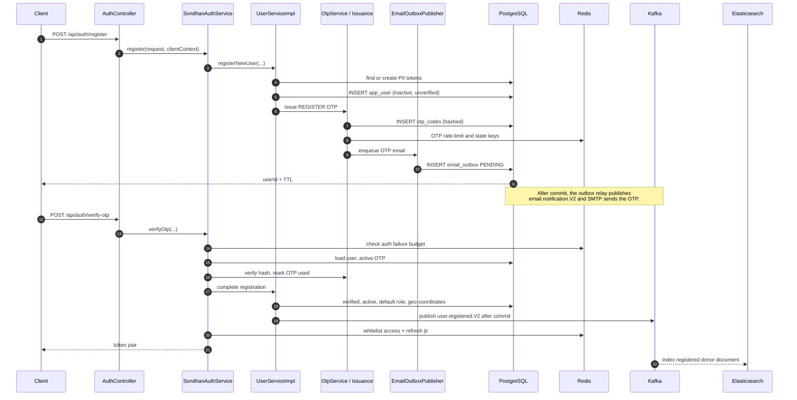

Login and refresh follow the same trust model:

1. **Login** resolves the identifier through the PII token hash, compares the
   password with BCrypt (cost 12), checks the account status, then issues and
   whitelists a token pair. Unknown accounts still run a dummy BCrypt comparison
   to reduce timing differences.
2. **Refresh** validates the signed refresh token, atomically consumes its
   Redis whitelist entry, and rotates it. Reuse of an already-consumed refresh
   token is treated as possible theft: all tokens for that user are revoked and
   an audit event is recorded.
3. **Logout** revokes both supplied tokens. Logout can parse an expired token
   for revocation purposes, but only after signature verification.

Authorization:

* Role checks use Spring method security (`@PreAuthorize`) and URL rules in
  `SecurityConfig`.
* The default role for a newly verified user is `ROLE_DONOR`.
* Administrative capabilities are restricted to `ORG_ADMIN` and the
  super-admin role. See [known gaps](#15-known-gaps-and-current-state) for the
  `SYSTEM_ADMIN` / `SUPER_ADMIN` naming caveat.
* CORS is an explicit allow-list from `sondhan.cors.allowed-origins`; wildcard
  origins are rejected at startup.
* CSRF is disabled because the API is stateless and uses bearer tokens, not
  browser-managed session cookies.

Brute-force controls:

| Control | Rule |
| --- | --- |
| Login failures | 10 failures per 5 minutes, scoped by client IP + resolved user |
| OTP verification failures | Same failure budget, scoped by purpose |
| OTP requests | 10 per hour per phone and per email |
| OTP verification lockout | 5 wrong attempts set an account lockout for 15 minutes |

---

## 7. PII protection

Raw email addresses and phone numbers are **not stored on `app_user`**. The
account holds foreign keys to `pii_tokens`:

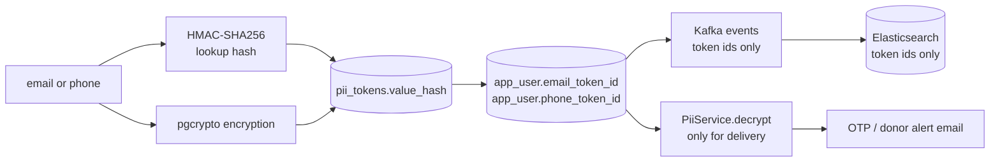

Rules:

* Lookup uses a keyed HMAC-SHA256 hash (`PII_HASH_KEY`). A legacy unkeyed
  SHA-256 lookup is still accepted for old rows; new values always use the
  keyed hash.
* `PiiTokenizer.findOrCreate` is transactional and unique-indexed on
  `(pii_type, value_hash)`.
* `UserRegisteredEvent` and `RegisteredDonorDocument` carry **token ids**, not
  plaintext PII. Admin Elasticsearch responses hide `email` and `phone` fields
  with `WRITE_ONLY` where those fields exist.
* Email bodies, OTP codes and recipient addresses are encrypted with
  AES-256-GCM (`EmailPayloadCipher`) before entering `email_outbox`, Kafka, or
  a DLQ.
* Logs mask identifiers and email addresses; raw tokens are never logged.

Key management caveat: losing `PII_ENCRYPTION_KEY` makes existing encrypted
values unrecoverable, and changing `PII_HASH_KEY` breaks identifier lookup.
Back these keys up in a real secret manager. See
[docs/container-deployment.md](container-deployment.md#3-configuration-and-secrets).

---

## 8. Event and topic model

Topics are derived from `KafkaTopics` and versioned by `kafka.topic.version`
(currently `V2`):

| Base event | Main topic | Retry topic | Dead-letter topic |
| --- | --- | --- | --- |
| `user.registered` | `user.registered.V2` | `user.registered.retry.V2` | `user.registered.dlq.V2` |
| `user.updated` | `user.updated.V2` | `user.updated.retry.V2` | `user.updated.dlq.V2` |
| `user.geo.enriched` | `user.geo.enriched.V2` | `user.geo.enriched.retry.V2` | `user.geo.enriched.dlq.V2` |
| `email.notification` | `email.notification.V2` | `email.notification.retry.V2` | `email.notification.dlq.V2` |

`BaseEvent` carries `eventId`, `topicName`, `eventType`, `eventTimeStamp`,
`retryCount`, `version`, `aggregateId`, `causationId` and `source`.

Producer and consumer behaviour:

| Path | Behaviour |
| --- | --- |
| `GenericKafkaEventProducer.publishEvent` | Fire-and-forget; on async failure publishes to retry (up to 3) then DLQ |
| `GenericKafkaEventProducer.publishEventBlocking` | Waits for broker acknowledgement; used by the outbox relay |
| `publishToDlqBlocking` | Waits for DLQ acknowledgement; used by the email consumer error handler |
| Consumer factory | Manual immediate acknowledgement, JSON deserialization with trusted packages and type mappings, error-handling deserializer, fixed backoff (3 retries at 1 s) |
| Consumer exhaustion | After the retry budget is spent the record is logged and skipped; the generic factory has no DLQ recoverer |
| Idempotency | `processed_events` keyed by `eventId`; the marker is removed if the handler throws, so a retry can succeed |
| Email consumer | Dedicated factory, dedicated group, 1 concurrent consumer, non-retryable payload errors, explicit DLQ recoverer |

The producer is configured with `acks=all`, idempotence enabled, compression,
and a bounded in-flight request count.

---

## 9. Registration, indexing and geo enrichment

### 9.1 Registration and search indexing

`user.registered.V2` is published **after the registration transaction
commits**. This avoids indexing an account that was rolled back.

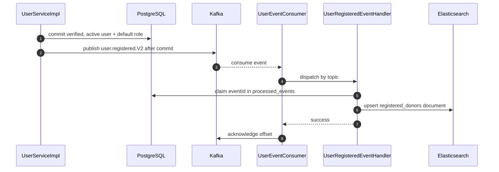

`UserRegisteredEventHandler` skips the write if a document with the same user id
already exists. A failed index write throws, the idempotency claim is
compensated, and Kafka retries the event.

### 9.2 Geo enrichment lifecycle

New accounts are created with geo status `PENDING`. OTP verification makes a
best-effort synchronous geocode of the city and stores the coordinates, but it
does not mark the row `COMPLETED`. The scheduled worker later claims the row,
geocodes the city again, and publishes `user.geo.enriched.V2`; the handler
applies the coordinates and moves the row to `COMPLETED`.

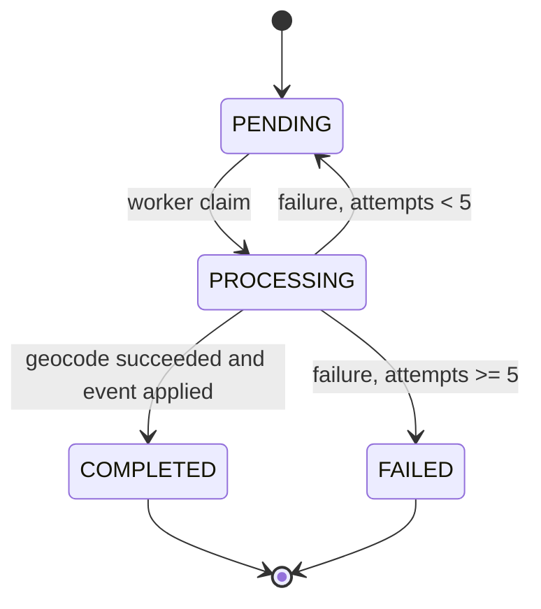

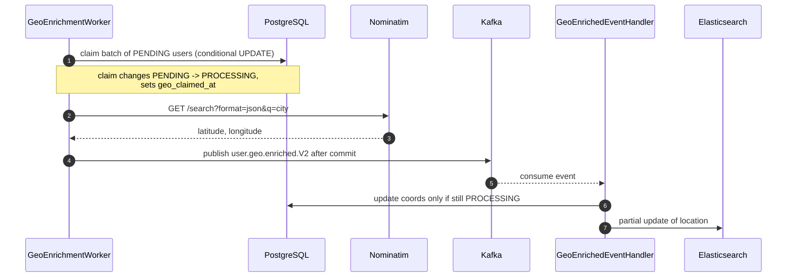

Worker properties:

| Property | Default | Meaning |
| --- | --- | --- |
| `geo.enrichment.poll-interval` | `10m` | Worker schedule |
| batch size | `20` | Users processed per run |
| throttle | `1100 ms` | Pause between geocoder calls (Nominatim usage policy) |
| retry limit | `5` | Attempts before `FAILED` |
| ShedLock name | `geoEnrichmentWorker` | One active worker across instances |
| geocoder timeout | `5 s` | Per request |

If the handler sees that the row is no longer `PROCESSING`, it logs and skips
the DB update. This protects against a second worker or a late event.

`GeoEnrichedEventHandler.handle(...)` opens a transaction at the handler
boundary. The geo update is a `@Modifying` JPQL query, which requires an active
transaction; without one the consumer fails with
`TransactionRequiredException` and the event is redelivered. The idempotency
marker is written in a separate `REQUIRES_NEW` transaction by
`JpaProcessedEventStore` and compensated if the handler later fails, so the
marker and the geo update are not committed as one unit.

> `blood_request` has geo-enrichment columns, but no worker currently claims or
> enriches requests. Only `app_user` is processed today.

---

## 10. Email notification pipeline

Email is the only notification transport used by the current code. Business
code never calls SMTP directly; it writes to `email_outbox` in the same
transaction.

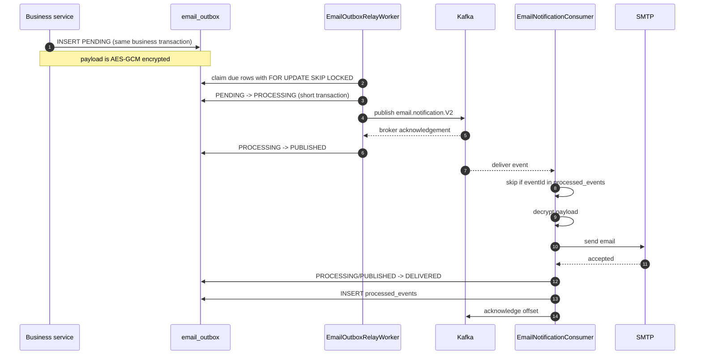

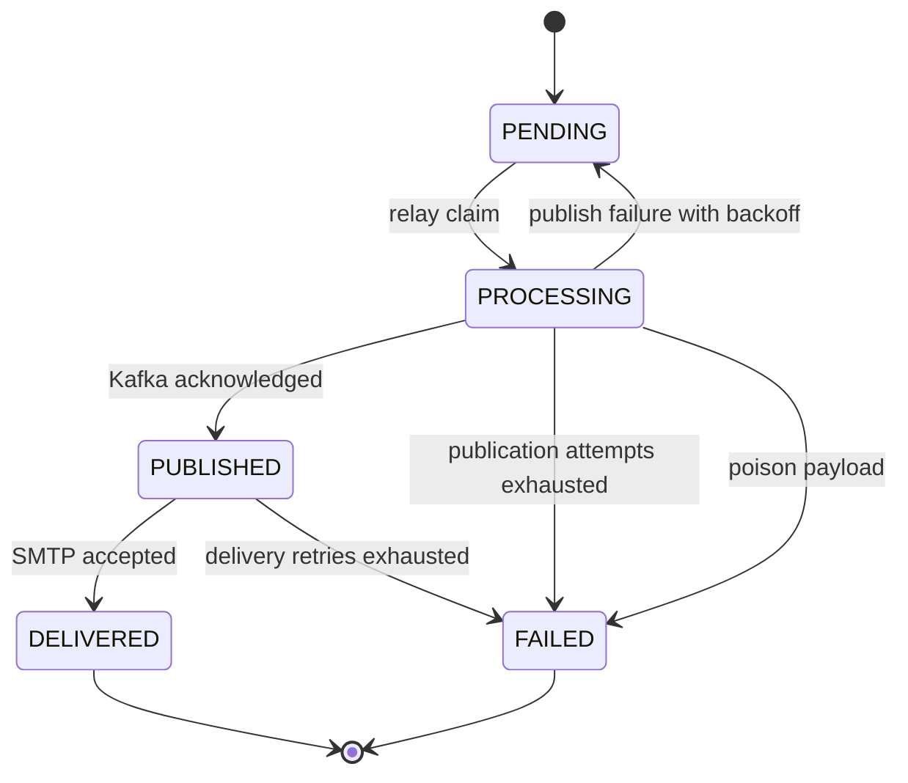

Guarantees and recovery:

* **At-least-once delivery.** The consumer records success after SMTP accepts
  the message. A crash in the narrow window between SMTP and the marker can
  produce a duplicate, never a silent loss.
* **Idempotency by `eventId`.** Duplicate Kafka deliveries are skipped.
* **Stale-claim recovery.** A row stuck in `PROCESSING` beyond
  `email.outbox.relay.stale-claim-timeout` is returned to `PENDING`.
* **Backoff.** Publication retries use exponential backoff capped at
  `email.outbox.relay.max-backoff`.
* **DLQ.** Delivery failures exhaust a bounded retry budget and are published
  to `email.notification.dlq.V2`; the outbox row is marked `FAILED`.
* **Retention.** A scheduled cleanup removes terminal `PUBLISHED`/`DELIVERED`
  rows after `email.outbox.retention`.

The full operational details, state machine and replay SQL are in
[docs/email-notification-outbox.md](email-notification-outbox.md).

---

## 11. Donor search and notification

### 11.1 Active search path

The wired path is `POST /api/search/eligible-donors →
DonorSearchServiceImpl`. It uses PostgreSQL for candidate selection and
in-memory Haversine distance calculation.

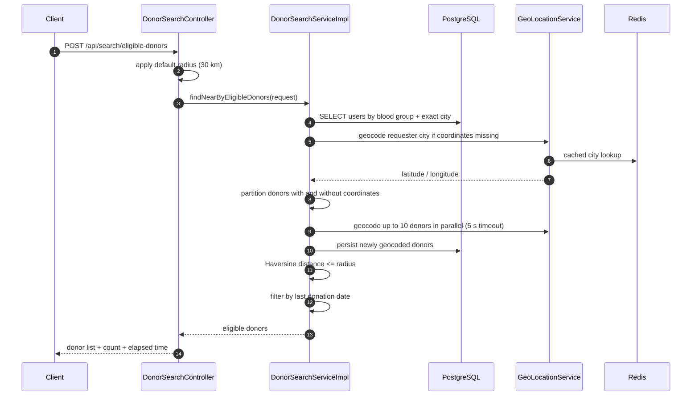

Current search details:

* The candidate query is **blood group + exact city**, not a geo radius query.
  Distance is applied afterwards in memory.
* The requester's city is geocoded through Nominatim and cached in Redis
  (`geolocations` cache, 30-day TTL).
* Up to ten donors without coordinates are geocoded per request, in parallel on
  the `geoFetchExecutor`, with a five-second deadline. Results are persisted.
* Radius defaults to `default.geo.search.radius` (30 km) when the request omits
  it or supplies a non-positive value; validation caps it at 500 km.
* `DonorUtils.filterEligibleDonors` currently compares `lastDonationDate`
  against a cutoff. See [known gaps](#15-known-gaps-and-current-state): the
  configured `min.days.between.donation` value is not injected into the static
  field, and the filter does not check availability or verification.

### 11.2 Administrative donor notification

`POST /api/search/notify-near-by-donors` is restricted to admins. It finds
nearby donors, filters eligibility, and calls `NotificationManager`, which
enqueues one `email_outbox` row per donor. SMTP is then handled asynchronously
by the outbox pipeline.

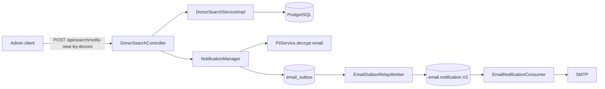

### 11.3 Reserved / not-yet-wired search stack

The repository contains a more advanced Redis GEO and Elasticsearch search
design that is **not connected to a controller**:

| Component | State |
| --- | --- |
| `RedisGeoSearchService` | Reads `geo:donors:<bloodGroup>` with `GEOSEARCH`, applies a 30 req/min Lua rate limit and emits Micrometer metrics. No active caller. |
| `RadiusExpander` | Expands common blood groups through 10/25/50 km and rare groups through 25/50/70 km. No active caller. |
| `ElasticSearchService` (geo-distance query) | Entire class is commented out. |
| `search/dto` donor events and analytics DTOs | Present but unused. |
| `DonorListPublisher` / `DonorListConsumer` | Legacy donor-list Kafka path. The publisher is not injected anywhere, and the configured topic names do not match (`blood-donor-notification` vs `blood-donor-notifications`). |

Treat these as **planned capabilities**, not part of the current runtime
contract, until an endpoint and index bootstrap are wired.

---

## 12. Audit logging

Security-relevant actions are recorded asynchronously:

| Event | Trigger |
| --- | --- |
| `REGISTER` | New account created |
| `LOGIN` | Successful or failed password login |
| `LOGOUT` | Tokens revoked |
| `OTP_SENT` / `OTP_FAILED` / `OTP_VERIFIED` / `OTP_REUSE_ATTEMPT` | OTP lifecycle and replay attempts |
| `REFRESH_TOKEN_ROTATED` | Refresh rotation |
| `REFRESH_REUSE_ATTACK` | Consumed refresh token reused |
| `ACCOUNT_LOCKED` | Locked account login attempt |
| `ROLE_CHANGED`, `TOKEN_REVOKED`, `ACCOUNT_DEACTIVATED` | Administrative/security events |

Implementation notes:

* `AuditService` is `@Async` and uses `REQUIRES_NEW`, so audit writes survive a
  rolled-back business transaction.
* `audit_logs` is partitioned by `created_at`; migration `V25` provides a
  partition-management function and a default partition exists.
* No automatic audit-retention job is currently scheduled. Partition
  maintenance/retention is an operational responsibility.

---

## 13. Reliability and failure handling

| Concern | Implementation |
| --- | --- |
| Database / Kafka consistency | Domain events publish after commit; email uses the transactional outbox |
| Duplicate delivery | `processed_events` by `eventId`; email consumer checks before sending |
| Producer failure | Retry topic, then DLQ; the blocking producer throws for the outbox relay |
| Consumer failure | Fixed backoff, then the generic factory logs and skips; only the email consumer has a DLQ recoverer and non-retryable payload errors |
| Worker duplication | ShedLock (`shedlock` table) limits scheduled jobs to one instance |
| Stale outbox claims | `locked_at` + stale-claim sweep |
| Concurrent outbox relays | `FOR UPDATE SKIP LOCKED` |
| Geo claim races | Conditional `UPDATE ... WHERE geo_status = 'PENDING'` |
| Geocoder outages | Bounded retries, `FAILED` after 5 attempts, Redis cache for successful cities |
| Graceful shutdown | `server.shutdown=graceful`, 30 s lifecycle timeout, 45 s container stop grace |
| Elasticsearch outage | Indexing fails, the event is retried three times, then skipped; PostgreSQL remains authoritative and the index must be rebuilt manually |

Important caveat: `GenericKafkaEventProducer.publishEvent` is fire-and-forget.
For events that must not be lost, use the outbox or the blocking publisher.
`UserServiceImpl` already publishes after commit and logs failures without
failing the client response, so a Kafka outage can leave the read model behind
until the event is replayed or the index is rebuilt manually.

---

## 14. Configuration map

| Area | Properties / environment |
| --- | --- |
| HTTP | `server.port=8088`, `server.servlet.context-path=/sondhan` |
| PostgreSQL | `DB_URL`, `DB_USERNAME`, `DB_PASSWORD` |
| Flyway | `spring.flyway.enabled=true`, `locations=classpath:/db/migration` |
| Kafka | `KAFKA_BOOTSTRAP_SERVERS`, `kafka.topic.version=V2`, producer acks/retries/compression |
| Email outbox | `email.outbox.relay.*`, `email.outbox.retention`, `sondhan.email.payload-key` |
| Redis | `REDIS_CLUSTER_NODES`, `REDIS_PASSWORD`, Lettuce cluster topology refresh |
| Elasticsearch | `ELASTICSEARCH_HOST`, `ELASTICSEARCH_PORT`, `ELASTICSEARCH_SCHEME`, index names |
| Geocoding | `geo.fetch.lat.long.url`, `geo.enrichment.poll-interval`, `default.geo.search.radius` |
| JWT | `JWT_ACCESS_TOKEN_VALIDITY`, `JWT_REFRESH_TOKEN_VALIDITY`, `JWT_ISSUER`, `RSA_PRIVATE_KEY_PATH`, `RSA_PUBLIC_KEY_PATH` |
| PII / OTP | `PII_ENCRYPTION_KEY`, `PII_HASH_KEY`, `OTP_HASH_KEY` |
| Auth limits | `AUTH_FAILURE_MAX_ATTEMPTS`, `AUTH_FAILURE_WINDOW_MINUTES` |
| CORS | `sondhan.cors.allowed-origins` / `CORS_ORIGIN_1..3` |
| Mail | `MAIL_HOST`, `MAIL_PORT`, `MAIL_USERNAME`, `MAIL_PASSWORD` |
| Actuator | `health,info` exposed; liveness/readiness probe groups enabled |
| API docs | `SPRINGDOC_ENABLED` |

Development configuration imports an optional `.env` file. Production overrides
this with Docker secrets through
`SPRING_CONFIG_IMPORT=optional:configtree:/run/secrets/`.

---

## 15. Known gaps and current state

These are deliberate notes so the architecture does not overstate what is
implemented:

1. **`user.updated` has no handler.** `UserEventConsumer` subscribes to it, but
   only `UserRegisteredEventHandler` and `GeoEnrichedEventHandler` are
   registered. An update event fails dispatch, is retried three times by the
   generic listener error handler, then is logged and skipped. There is no
   handler-level DLQ for this consumer.
2. **Redis GEO search is not wired.** `RedisGeoSearchService` and
   `RadiusExpander` have no callers. The active donor search is SQL + Haversine
   in `DonorSearchServiceImpl`.
3. **Elasticsearch geo-distance search is commented out.**
4. **Donor-list Kafka path is legacy.** `DonorListPublisher` is unused and its
   topic (`blood-donor-notification`) differs from the consumer topic
   (`blood-donor-notifications`). The active notification path goes directly
   through `NotificationManager` to the outbox.
5. **Eligibility filter is incomplete.** `DonorUtils.minGapDays` is a static
   field annotated with `@Value`; Spring does not inject static fields, so the
   cutoff behaves as zero days. The filter also ignores `isAvailable` and
   `isVerified`.
6. **Role naming drift.** Migrations seed `ROLE_SYSTEM_ADMIN`, while URL and
   method security reference `SUPER_ADMIN` (which maps to `ROLE_SUPER_ADMIN`).
   The seeded system-admin role will not satisfy those checks until the names
   are reconciled.
7. **Blood-request geo enrichment is not implemented.** Columns exist, but no
   worker processes `blood_request` rows.
8. **Two Elasticsearch models share `registered_donors`.** The read model is
   `RegisteredDonorDocument`; the admin API uses `DonorSearchDocument`. The
   admin paginated repository points at `donor_search_index` while the
   document annotation points at `registered_donors`; verify index alignment
   before relying on admin search.
9. **JWT keys are ephemeral without explicit paths.** In development, a
   temporary RSA key pair is generated, so tokens do not survive a restart and
   are not shared across instances. Production must mount a stable key pair.
   There is no `kid`-based key rotation yet.
10. **No audit retention job.** Audit partitions and retention are operational
    tasks; the default partition exists but old partitions are not dropped
    automatically.
11. **Spring Session is present but unused for authentication.** The
    dependency is declared, but no session store is configured; the security
    filter chain is `STATELESS` and no Spring Session filter is enabled, so
    sessions are not part of the auth path.
12. **Flyway validation is disabled** (`validate-on-migrate=false`) pending
    environment baselining. Enable it when all environments have a clean
    history.
13. **No request-ID propagation.** Logback includes a `requestId` MDC field,
    but no servlet filter or client-context builder populates it, so log lines
    cannot currently be correlated to a request.
14. **No stale-claim recovery for geo enrichment.** A row left in `PROCESSING`
    by a crash or a failed event publish is not swept back to `PENDING`; only
    `app_user` rows in `PENDING` are picked up by the worker.
15. **No automated Elasticsearch reindex job.** The read model can be rebuilt
    from PostgreSQL, but recovery currently requires a manual replay or
    bulk-index operation.

---

## 16. Keeping this document current

Every development change that affects architecture must update this file in the
same commit/PR. Use this checklist:

- [ ] Did a new component, package, external dependency or data store appear?
      Update the context/container diagrams and the package table.
- [ ] Did an API endpoint, auth rule, or role change? Update the API and
      authentication sections.
- [ ] Did a table, index, Redis key family or event/topic change? Update the
      data model and event tables.
- [ ] Did a background job, retry policy or failure mode change? Update the
      reliability section and the relevant sequence/state diagram.
- [ ] Did deployment topology or configuration change? Update the configuration
      table and [docs/container-deployment.md](container-deployment.md) if
      operating procedures changed.
- [ ] Add a row to the change log below.

Recommended style:

* Keep diagrams at the **component / flow** level. Do not turn this into a class
  diagram.
* Prefer a sequence diagram for a multi-step flow and a state diagram for a
  lifecycle.
* Mark planned or dormant code explicitly as **reserved** or **not wired**, as
  done in [section 11.3](#113-reserved--not-yet-wired-search-stack).
* Link to focused documents (outbox, deployment) instead of duplicating their
  operational detail.

---

## 17. Change log

| Date | Change | Where |
| --- | --- | --- |
| 2026-11-15 | Initial architecture document: context, containers, domain model, APIs, auth, PII, event flows, outbox, search, geo enrichment, audit, reliability, gaps | `docs/architecture.md` |
| 2026-11-15 | Documented the geo-enrichment handler transaction boundary; the `@Modifying` geo update now runs inside `GeoEnrichedEventHandler.handle(...)`, with the idempotency marker in a separate `REQUIRES_NEW` transaction | §9.2, `GeoEnrichedEventHandler` |
| 2026-11-15 | Adopted Compose project `sondhan` and migrated existing dev data into `sondhan_*` volumes; pinned PostgreSQL to the Debian `postgres:15` image for collation compatibility; fixed the Redis service anchor and Elasticsearch log-index replicas | `docs/container-deployment.md` |
